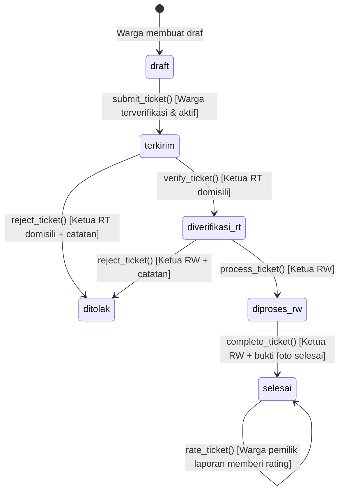

# SIPANDU — Sistem Informasi Pelayanan Warga Terpadu RW 06

> Platform digital tata kelola aspirasi, pelaporan masalah lingkungan, dan pelayanan publik warga RW 06 Parakan Saat, Kelurahan Cisaranten Endah, Kecamatan Arcamanik, Kota Bandung.
> Repositori ini dirancang khusus dengan target arsitektur: **Next.js 16 di Vercel** dan **PostgreSQL 17, Authentication, Storage, & RPC di Supabase Hosted**.

---

## Target Arsitektur Hosted-Only

SIPANDU beroperasi sepenuhnya di atas infrastruktur *cloud-hosted* terkelola:

| Komponen | Platform Hosting | Cakupan Layanan |
|---|---|---|
| **Frontend & Runtime Server** | [Vercel](https://vercel.com/) | Next.js 16 App Router, Turbopack, Server Actions, Route Handlers, Edge Middleware |
| **Backend & Database** | [Supabase Hosted](https://supabase.com/) | PostgreSQL 17, Supabase Auth, Supabase Storage (`ticket-attachments`, `avatars`), RLS 100%, RPC Stored Procedures |

Pengembang dan evaluator dapat memasang, mengonfigurasi, menguji, dan menjalankan SIPANDU dari awal menggunakan akun Vercel dan project Supabase Hosted baru.

## Tentang SIPANDU

**SIPANDU** (Sistem Informasi Pelayanan Warga Terpadu) adalah aplikasi web layanan publik berbasis komunitas yang mendigitalkan birokrasi warga di tingkat Rukun Warga (RW) dan Rukun Tetangga (RT).

SIPANDU diinisialisasi untuk wilayah **RW 06 Parakan Saat, Kelurahan Cisaranten Endah, Kecamatan Arcamanik, Kota Bandung** (mencakup RT 01 hingga RT 09). Arsitektur aplikasi bersifat *single-tenant* (1 instalasi melayani 1 RW), di mana identitas wilayah dapat disesuaikan dinamis melalui variabel lingkungan:
- `NEXT_PUBLIC_APP_RW`: Nomor RW (default: `"06"`).
- `NEXT_PUBLIC_APP_AREA_NAME`: Nama area atau rukun warga (default: `"Parakan Saat, Bandung"`).
- `NEXT_PUBLIC_APP_CITY`: Kota administrasi (default: `"Kota Bandung"`).

Pelaporan warga yang sebelumnya dilakukan secara lisan atau melalui grup pesan instan bertransformasi menjadi alur kerja yang **terstruktur, transparan, akuntabel, dan terlacak secara real-time**.

---

## Peran Pengguna & Hierarki Akses (RBAC)

SIPANDU menerapkan kontrol akses berbasis peran (*Role-Based Access Control*) berjenjang:

| Peran | Lingkup Wilayah | Tanggung Jawab & Hak Akses Kunci |
|---|:---:|---|
| **Warga** | RT domisili | Membuat draf laporan, mengunggah foto bukti laporan (*before*), mengirim tiket pengaduan (setelah akun diverifikasi oleh Ketua RT), memantau kronologi penanganan, serta memberikan rating dan ulasan setelah perbaikan selesai. |
| **Ketua RT** | RT binaan | Memverifikasi identitas pendaftaran warga di RT-nya (`verify_resident`), memeriksa kelayakan tiket warga setempat, memverifikasi tiket untuk diteruskan ke RW (`verify_ticket`), atau menolak tiket disertai alasan resmi (`reject_ticket`). |
| **Ketua RW** | RW 06 (RT 01–09) | Memproses tiket yang lolos verifikasi RT (`process_ticket`), mengoordinasikan penanganan lapangan, mengunggah bukti foto penyelesaian (*after*), menyelesaikan tiket (`complete_ticket`), serta memantau analitik dan rekap laporan seluruh RW. |
| **Admin** | Sistem / Global | Mengelola data master wilayah dan kategori, mengelola status akun pengguna (aktivasi/verifikasi/reset), menghapus/mengoreksi tiket bermasalah dengan audit trail, serta mengawasi integritas operasional sistem. |

---

## Alur Siklus Pengaduan (State Machine)

Setiap tiket pengaduan melewati mesin status (*finite state machine*) yang diatur ketat oleh fungsi RPC PostgreSQL (`SECURITY DEFINER`):



Setiap transisi status secara otomatis mencatat riwayat ke tabel `ticket_timeline` dan mengirimkan entri notifikasi ke tabel `notifications`.

---

## Tech Stack & Arsitektur Cloud

### Frontend & Application Layer (Hosted on Vercel)
- **Framework**: [Next.js](https://nextjs.org/) `16.4.3` (App Router, Turbopack, Server Actions)
- **Library UI**: [React](https://react.dev/) `19.3.1`
- **Styling**: [Tailwind CSS](https://tailwindcss.com/) `v4` (dengan `@tailwindcss/turbopack`)
- **Icons**: [Lucide React](https://lucide.dev/)
- **Bahasa**: [TypeScript](https://www.typescriptlang.org/) `v6` (Strict Mode)
- **Spreadsheet Export**: `xlsx` (Ekspor rekapitulasi data laporan untuk pengurus RW)

### Backend, Database & Storage Layer (Hosted on Supabase Cloud)
- **BaaS & Auth**: [Supabase Hosted](https://supabase.com/) (`@supabase/ssr` & `@supabase/supabase-js`)
- **Database Engine**: [PostgreSQL](https://www.postgresql.org/) `17`
- **Keamanan & Otorisasi**: Row Level Security (RLS) diaktifkan 100% pada seluruh tabel publik
- **Logika Server**: Stored Procedures / RPC Functions (`SECURITY DEFINER`) dengan parameterisasi aman
- **File Storage**: Supabase Storage Buckets (`ticket-attachments` dan `avatars`) yang diproteksi RLS tingkat objek

---

## Silsilah Migrasi Database Kanonik (0001–0010)

Seluruh struktur skema, keamanan, master data, dan logika database didefinisikan secara deklaratif dalam 10 file migrasi kanonik pada `supabase/migrations/`:

| No | File Migrasi | Deskripsi & Cakupan Fungsional |
|:---:|---|---|
| **01** | `20261101120001_sipandu_init.sql` | Inisialisasi enum tipe data, 7 tabel inti (`regions`, `categories`, `profiles`, `tickets`, `ticket_attachments`, `ticket_timeline`, `notifications`), baseline RLS, bucket `ticket-attachments`, serta seed master data RT 01–RT 08 & 6 kategori laporan. |
| **02** | `20261101120002_fix_attachments_and_indexes.sql` | Helper penghitung lampiran `_count_laporan_attachments`, policy insert lampiran foto, dan 7 indeks performa foreign key. |
| **03** | `20261101120003_verification_active_guards.sql` | Kolom `is_rt_verified`, helper `_is_caller_active()`, status active guards, dan proteksi profil warga dari modifikasi ilegal (dengan normalisasi delimiter fungsi `AS $$ ... $$;`). |
| **04** | `20261101120004_avatars_bucket.sql` | Pembuatan storage bucket publik `avatars` untuk foto profil pengguna. |
| **05** | `20261101122337_admin_rls_and_delete.sql` | Policy pembacaan bukti penyelesaian tiket oleh Admin & RW, serta policy penghapusan tiket administratif `tickets_admin_delete`. |
| **06** | `20261101122344_pending_user_verification.sql` | RPC `verify_resident(uuid, boolean)` dengan validasi wilayah RT, pengiriman notifikasi approval, dan pemblokiran pembuatan tiket warga pending. |
| **07** | `20261109000001_admin_protection_and_profile_guards.sql` | Helper role checking real-time (`_is_caller_admin`, `_get_caller_role`), trigger invariant admin terakhir (`tr_protect_last_admin`), trigger proteksi profil (`tr_check_profile_guards`), dan preflight assertion cerdas (melewati pemeriksaan dengan `NOTICE` pada database baru yang masih kosong / 0 user, serta mewajibkan minimal 1 Admin aktif pada database yang sudah berisi user). |
| **08** | `20261109000002_storage_and_privilege_hardening.sql` | Penambahan master data RT 09, penguatan 4 storage policies bucket `avatars` (`read`, `insert`, `update`, `delete`), schema anti-hijacking (`REVOKE CREATE ON SCHEMA public`), Principle of Least Privilege (PoLP) tabel dan fungsi, serta default privileges. |
| **09** | `20261109000003_deduplicate_rt09_and_unique_constraint.sql` | Deduplikasi dinamis record wilayah RT 09, penataan ulang sequence `public.regions.id` via `ALTER SEQUENCE ... RESTART WITH`, dan penambahan constraint integritas `UNIQUE (name, rw)` pada `public.regions`. |
| **10** | `20261110000001_fix_null_region_auth_bypass.sql` | Perbaikan celah otorisasi wilayah *three-valued logic* (`NULL` comparison) pada RPC `verify_ticket`, `reject_ticket`, dan `verify_resident` menggunakan validasi eksplisit `IS NULL` serta operator NULL-safe `IS DISTINCT FROM`. |

---

## Prasyarat Sistem

Sebelum memulai instalasi, pastikan dependensi berikut terpasang pada komputer pengembang:

- **Node.js**: `v20.x` LTS atau lebih baru (`node -v`)
- **Package Manager**: `npm` `v9+` atau `v10+` (`npm -v`)
- **Supabase CLI**: `v3.0.0+` (`npx supabase -v`)
- **Git**: Terpasang untuk kloning repositori (`git -v`)
- **Akun Layanan Cloud**:
  - Akun [Supabase](https://supabase.com/) aktif untuk membuat project hosted baru.
  - Akun [Vercel](https://vercel.com/) aktif untuk deployment aplikasi web.

> [!NOTE]
> Seluruh alur kerja migrasi, pengujian, dan runtime aplikasi ditujukan langsung ke layanan Supabase Hosted dan Vercel.

---

## Daftar Lengkap Environment Variables

Berdasarkan audit menyeluruh terhadap kode sumber aplikasi, berikut adalah daftar variabel lingkungan yang digunakan:

### A. Variabel Publik Frontend (`NEXT_PUBLIC_*`)
Variabel ini dibaca oleh Next.js dan di-inline ke dalam JavaScript bundle saat proses build. Setiap perubahan nilai memerlukan build / redeployment ulang di Vercel agar berlaku pada klien.

| Nama Variabel | Wajib / Opsional | Deskripsi & Contoh Nilai |
|---|:---:|---|
| `NEXT_PUBLIC_SUPABASE_URL` | **Wajib** | URL instance Supabase Hosted Anda, contoh: `https://<project-ref>.supabase.co` |
| `NEXT_PUBLIC_SUPABASE_ANON_KEY` | **Wajib** | Supabase Anon Key (aman untuk browser frontend) |
| `NEXT_PUBLIC_APP_NAME` | Opsional | Nama singkat aplikasi (default: `"SIPANDU"`) |
| `NEXT_PUBLIC_APP_RW` | Opsional | Nomor RW cakupan aplikasi (default: `"06"`) |
| `NEXT_PUBLIC_APP_AREA_NAME` | Opsional | Nama wilayah atau kelurahan (default: `"Parakan Saat, Bandung"`) |
| `NEXT_PUBLIC_APP_CITY` | Opsional | Kota administrasi (default: `"Kota Bandung"`) |
| `NEXT_PUBLIC_APP_CONTACT_ADDRESS` | Opsional | Alamat sekretariat RW untuk halaman bantuan (default: `null`) |
| `NEXT_PUBLIC_APP_CONTACT_PHONE` | Opsional | Nomor telepon / WhatsApp sekretariat RW (default: `null`) |

### B. Variabel Server-Side Secret
Variabel ini bersifat rahasia dan **HANYA** digunakan oleh runtime server (Server Actions, Route Handlers) di Vercel serta skrip administratif di terminal lokal pengembang.

| Nama Variabel | Wajib / Opsional | Deskripsi |
|---|:---:|---|
| `SUPABASE_SERVICE_ROLE_KEY` | **Wajib** | Supabase Service Role Secret Key. Memiliki akses penuh melewati RLS. **DILARANG KERAS** diekspos ke klien browser, dimasukkan ke repositori Git, atau diberi prefix `NEXT_PUBLIC_`. |

---

## Panduan Setup Supabase Hosted & Migrasi

### Langkah 1: Kloning Repositori & Instal Dependensi

```bash
git clone https://github.com/Kelompok-60B-UT/SIPANDU.git
cd SIPANDU
npm install
```

### Langkah 2: Buat Project Baru di Supabase Dashboard

1. Buka [Supabase Dashboard](https://supabase.com/dashboard) dan buat organisasi atau project baru.
2. Beri nama project (misalnya `sipandu-rw06`), tentukan password database PostgreSQL yang kuat, dan pilih region terdekat (misalnya `Singapore` - `ap-southeast-1`).
3. Tunggu hingga proses provisi database selesai (sekitar 1–2 menit).
4. Masuk ke menu **Project Settings** -> **API**, lalu catat:
   - **Project URL** (`https://<project-ref>.supabase.co`)
   - **Project Reference ID** (`<project-ref>`)
   - **anon / public key**
   - **service_role key** (Secret)

### Langkah 3: Konfigurasi File Environment Lokal

Salin template konfigurasi lingkungan:

```bash
cp .env.example .env.local
```

Buka `.env.local` dan isi dengan kredensial project Supabase Hosted yang baru dibuat:

```env
NEXT_PUBLIC_SUPABASE_URL="https://<YOUR_PROJECT_REF>.supabase.co"
NEXT_PUBLIC_SUPABASE_ANON_KEY="<YOUR_ANON_KEY>"
SUPABASE_SERVICE_ROLE_KEY="<YOUR_SERVICE_ROLE_KEY>"
```

### Langkah 4: Hubungkan Supabase CLI ke Project Hosted

Login ke akun Supabase Anda melalui CLI:

```bash
npx supabase login
```

Tautkan workspace lokal ke project hosted baru:

```bash
npx supabase link --project-ref <YOUR_PROJECT_REF>
```

### Langkah 5: Terapkan 10 Migrasi Kanonik ke Remote Database

Sebelum menerapkan perubahan skema ke remote database, selalu lakukan pemeriksaan awal dengan opsi `--dry-run`:

```bash
# 1. Periksa daftar migrasi yang akan diterapkan ke remote:
npx supabase db push --remote --dry-run

# 2. Terapkan seluruh migrasi kanonik ke database remote (wajib menyertakan flag --remote eksplisit):
npx supabase db push --remote
```

---

## Panduan Deployment ke Vercel

Setelah database Supabase Hosted siap dan akun Administrator telah dibuat, deploy aplikasi Next.js ke Vercel:

1. **Push repositori** ke akun GitHub organisasi Anda.
2. Buka [Vercel Dashboard](https://vercel.com/new) dan impor repositori **SIPANDU**.
3. **Konfigurasi Project**:
   - **Framework Preset**: Pilih `Next.js`.
   - **Root Directory**: `./`.
   - **Build Command**: `next build` (bawaan).
   - **Output Directory**: `.next` (bawaan).
4. **Environment Variables**:
   Tambahkan variabel lingkungan berikut pada dashboard Vercel (**Project Settings → Environment Variables**). Pastikan mencentang kedua opsi environment: **Production** dan **Preview**:
   - `NEXT_PUBLIC_SUPABASE_URL`: `https://<YOUR_PROJECT_REF>.supabase.co`
   - `NEXT_PUBLIC_SUPABASE_ANON_KEY`: `<YOUR_ANON_KEY>`
   - `SUPABASE_SERVICE_ROLE_KEY`: `<YOUR_SERVICE_ROLE_KEY>`
   - `NEXT_PUBLIC_APP_NAME`: `SIPANDU`
   - `NEXT_PUBLIC_APP_RW`: `06`
   - `NEXT_PUBLIC_APP_AREA_NAME`: `Parakan Saat, Bandung`
   - `NEXT_PUBLIC_APP_CITY`: `Kota Bandung`

   > [!IMPORTANT]
   > Variabel dengan prefix `NEXT_PUBLIC_*` disematkan (*inlined*) ke bundle JavaScript klien pada saat proses build (`next build`). Pastikan seluruh variabel di atas telah disimpan pada environment **Production** dan **Preview** sebelum memicu deployment, atau lakukan **Redeploy** jika variabel baru ditambahkan setelah build pertama.
5. **Deploy**: Klik tombol **Deploy** dan tunggu proses kompilasi Next.js selesai hingga Vercel menerbitkan domain produksi (misalnya `https://sipandu-rw06.vercel.app`).
6. **Sesuaikan Supabase Auth Redirect URLs**:
   Masuk ke **Supabase Dashboard** -> **Authentication** -> **URL Configuration**:
   - **Site URL**: Masukkan domain produksi Vercel Anda (misalnya `https://sipandu-rw06.vercel.app`).
   - **Redirect URLs**: Tambahkan:
     - `https://sipandu-rw06.vercel.app/**`
     - `https://sipandu-rw06.vercel.app/auth/callback`

---

## Menjalankan Aplikasi secara Lokal (Dev Mode)

Jika Anda ingin menjalankan server Next.js pada komputer lokal dengan menghubungkan frontend ke database Supabase Hosted yang sudah dikonfigurasi pada `.env.local`:

```bash
# Menjalankan development server Next.js (Turbopack)
npm run dev

# Memeriksa kualitas kode melalui ESLint
npm run lint

# Memeriksa kompilasi build produksi Next.js
npm run build
```

Buka [http://localhost:3000](http://localhost:3000) pada peramban web Anda.

---

## Lisensi & Referensi Dokumentasi

Dokumentasi detail operasional dan panduan teknis deployment dapat dilihat pada:
- [`INSTALL_RUNBOOK.md`](docs/deployment/INSTALL_RUNBOOK.md): Panduan instalasi dan deployment teknis terperinci.
- [`AGENTS.md`](AGENTS.md): Panduan arsitektur Next.js.

Proyek ini dikembangkan oleh **Kelompok 60B UT**  sebagai tugas akhir *Capstone Project* Sistem Informasi Pelayanan Warga.
