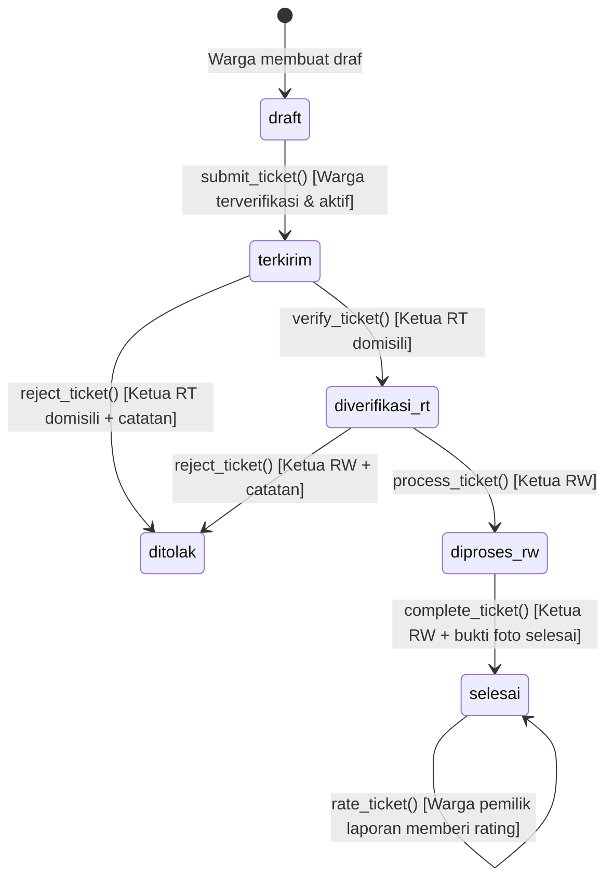

# SIPANDU — Sistem Informasi Pelayanan Warga Terpadu RW 06

> Platform digital tata kelola aspirasi, pelaporan masalah lingkungan, dan pelayanan publik warga RW 06 Parakan Saat, Kelurahan Cisaranten Endah, Kecamatan Arcamanik, Kota Bandung berbasis Next.js 16, PostgreSQL 17, dan Supabase.

---

## 📋 Daftar Isi

1. [Tentang SIPANDU](#-tentang-sipandu)
2. [Peran Pengguna & Hierarki Akses (RBAC)](#-peran-pengguna--hierarki-akses-rbac)
3. [Alur Siklus Pengaduan (State Machine)](#-alur-siklus-pengaduan-state-machine)
4. [Tech Stack & Arsitektur](#-tech-stack--arsitektur)
5. [Silsilah Migrasi Database Kanonik (0001–0009)](#-silsilah-migrasi-database-kanonik-00010009)
6. [Prasyarat Sistem](#-prasyarat-sistem)
7. [Panduan Instalasi & Setup Lokal](#-panduan-instalasi--setup-lokal)
   - [Langkah 1: Kloning Repositori & Instal Dependensi](#langkah-1-kloning-repositori--instal-dependensi)
   - [Langkah 2: Konfigurasi Environment Variables](#langkah-2-konfigurasi-environment-variables)
   - [Langkah 3: Setup Database Supabase Baru (Blank Database)](#langkah-3-setup-database-supabase-baru-blank-database)
   - [Langkah 4: Bootstrap Root Administrator](#langkah-4-bootstrap-root-administrator)
   - [Langkah 5: Seeding Pengguna & Tiket Demo (Opsional)](#langkah-5-seeding-pengguna--tiket-demo-opsional)
8. [Menjalankan Aplikasi](#-menjalankan-aplikasi)
9. [Panduan Deployment ke Vercel](#-panduan-deployment-ke-vercel)
10. [Prinsip Keamanan & Tata Kelola Data](#-prinsip-keamanan--tata-kelola-data)
11. [Pengujian Backend & RLS](#-pengujian-backend--rls)
12. [Troubleshooting & FAQ](#-troubleshooting--faq)

---

## 📖 Tentang SIPANDU

**SIPANDU** (Sistem Informasi Pelayanan Warga Terpadu) adalah aplikasi web layanan publik berbasis komunitas yang dirancang untuk mendigitalkan birokrasi warga di tingkat Rukun Warga (RW) dan Rukun Tetangga (RT).

SIPANDU secara default diinisialisasi untuk wilayah **RW 06 Parakan Saat, Kelurahan Cisaranten Endah, Kecamatan Arcamanik, Kota Bandung** (mencakup RT 01 hingga RT 09). Arsitektur aplikasi bersifat *single-tenant* (1 instalasi melayani 1 RW), di mana identitas wilayah dapat disesuaikan secara dinamis melalui konfigurasi variabel lingkungan:
- `NEXT_PUBLIC_APP_RW`: Nomor RW (default: `"06"`).
- `NEXT_PUBLIC_APP_AREA_NAME`: Nama area atau rukun warga (default: `"Parakan Saat, Bandung"`).
- `NEXT_PUBLIC_APP_CITY`: Kota administrasi (default: `"Kota Bandung"`).

Sebelumnya, pelaporan warga di lingkungan RW 06 dilakukan secara lisan atau melalui grup pesan instan yang sering kali tidak terdokumentasi, rentan tercecer, dan lambat ditindaklanjuti. SIPANDU mentransformasikan proses ini menjadi alur kerja yang **terstruktur, transparan, akuntabel, dan terlacak secara real-time**.

---

## 👥 Peran Pengguna & Hierarki Akses (RBAC)

SIPANDU menerapkan kontrol akses berbasis peran (*Role-Based Access Control*) berjenjang:

| Peran | Lingkup Wilayah | Tanggung Jawab & Hak Akses Kunci |
|---|:---:|---|
| **Warga** | RT domisili | Membuat draf laporan, mengunggah bukti foto awal (*before*), mengirim tiket pengaduan (setelah akun diverifikasi oleh Ketua RT), memantau riwayat & timeline, serta memberikan rating dan ulasan setelah perbaikan selesai. |
| **Ketua RT** | RT binaan | Memverifikasi identitas dan domisili pendaftaran warga di RT-nya (`verify_resident`), memeriksa kelayakan tiket warga setempat, memverifikasi tiket untuk eskalasi ke RW (`verify_ticket`), atau menolak tiket disertai alasan resmi (`reject_ticket`). |
| **Ketua RW** | RW 06 (RT 01–09) | Memproses tiket yang telah lolos verifikasi RT (`process_ticket`), mengoordinasikan penanganan lapangan, mengunggah bukti foto penyelesaian (*after*), menyelesaikan tiket (`complete_ticket`), serta memantau analitik dan rekap laporan seluruh RW. |
| **Admin** | Sistem / Global | Mengelola data master wilayah dan kategori, mengelola status akun pengguna (aktivasi/verifikasi/reset), menghapus/mengoreksi tiket bermasalah dengan audit trail, serta mengawasi integritas operasional sistem. |

---

## 🔄 Alur Siklus Pengaduan (State Machine)

Setiap tiket pengaduan melewati mesin status (*finite state machine*) yang diatur ketat oleh fungsi RPC PostgreSQL (`SECURITY DEFINER`):



Setiap transisi status secara otomatis mencatat riwayat ke tabel `ticket_timeline` dan mengirimkan entri ke tabel `notifications`.

---

## 🛠 Tech Stack & Arsitektur

### Frontend & Application Layer
- **Framework**: [Next.js](https://nextjs.org/) `16.4.3` (App Router, Turbopack, Server Actions)
- **Library UI**: [React](https://react.dev/) `19.3.1`
- **Styling**: [Tailwind CSS](https://tailwindcss.com/) `v4` (dengan `@tailwindcss/turbopack`)
- **Icons**: [Lucide React](https://lucide.dev/)
- **Bahasa**: [TypeScript](https://www.typescriptlang.org/) `v6` (Strict Mode)
- **Spreadsheet Export**: `xlsx` (Rekap laporan pengaduan untuk pengurus RW)

### Backend, Database & Storage Layer
- **BaaS & Auth**: [Supabase](https://supabase.com/) (`@supabase/ssr` & `@supabase/supabase-js`)
- **Database Engine**: [PostgreSQL](https://www.postgresql.org/) `17`
- **Security & RBAC**: Row Level Security (RLS) diaktifkan 100% pada seluruh tabel publik
- **Logic Encapsulation**: Stored Procedures / RPC Functions (`SECURITY DEFINER`) dengan parameterisasi aman
- **File Storage**: Supabase Storage Buckets (`ticket-attachments` dan `avatars`) yang diproteksi RLS tingkat objek

---

## 📜 Silsilah Migrasi Database Kanonik (0001–0009)

Seluruh struktur skema, keamanan, master data, dan logika database didefinisikan secara deklaratif dalam 9 file migrasi kanonik pada `supabase/migrations/`:

| No | File Migrasi | Deskripsi & Cakupan Fungsional |
|:---:|---|---|
| **01** | `20261101120001_sipandu_init.sql` | Enum tipe data, 7 tabel inti (`regions`, `categories`, `profiles`, `tickets`, `ticket_attachments`, `ticket_timeline`, `notifications`), baseline RLS, bucket `ticket-attachments`, serta seed master data RT 01–RT 08 & 6 kategori laporan. |
| **02** | `20261101120002_fix_attachments_and_indexes.sql` | Helper penghitung lampiran `_count_laporan_attachments`, policy insert lampiran foto, dan 7 indeks performa foreign key. |
| **03** | `20261101120003_verification_active_guards.sql` | Kolom `is_rt_verified`, helper `_is_caller_active()`, status active guards, dan proteksi profil warga dari modifikasi ilegal. |
| **04** | `20261101120004_avatars_bucket.sql` | Pembuatan storage bucket publik `avatars` untuk foto profil pengguna. |
| **05** | `20261101122337_admin_rls_and_delete.sql` | Policy pembacaan bukti penyelesaian tiket oleh Admin & RW, serta policy penghapusan tiket administratif `tickets_admin_delete`. |
| **06** | `20261101122344_pending_user_verification.sql` | RPC `verify_resident(uuid, boolean)` dengan validasi wilayah RT, pengiriman notifikasi approval, dan pemblokiran pembuatan tiket warga pending. |
| **07** | `20261109000001_admin_protection_and_profile_guards.sql` | Helper real-time role checking (`_is_caller_admin`, `_get_caller_role`), trigger penegakan invariant admin terakhir (`tr_protect_last_admin`), trigger proteksi profil (`tr_check_profile_guards`), dan preflight check adaptif database kosong. |
| **08** | `20261109000002_storage_and_privilege_hardening.sql` | Penambahan master data RT 09, penguatan 4 storage policies bucket `avatars` (`read`, `insert`, `update`, `delete`), schema anti-hijacking (`REVOKE CREATE ON SCHEMA public`), Principle of Least Privilege (PoLP) tabel dan fungsi, serta default privileges. |
| **09** | `20261109000003_deduplicate_rt09_and_unique_constraint.sql` | Deduplikasi dinamis record wilayah RT 09, penataan ulang sequence `public.regions.id` via `ALTER SEQUENCE ... RESTART WITH`, dan penambahan constraint integritas `UNIQUE (name, rw)` pada `public.regions`. |

---

## 💻 Prasyarat Sistem

Sebelum memulai instalasi, pastikan dependensi berikut terpasang pada komputer pengembang:

- **Node.js**: `v20.x` LTS atau lebih baru (`node -v`)
- **Package Manager**: `npm` `v9+` atau `v10+` (`npm -v`)
- **Supabase CLI**: `v3.0.0+` (`npx supabase -v`)
- **Git**: Terpasang untuk kloning repositori (`git -v`)

---

## 🚀 Panduan Instalasi & Setup Lokal

### Langkah 1: Kloning Repositori & Instal Dependensi

```bash
git clone https://github.com/Kelompok-60B-UT/SIPANDU.git
cd SIPANDU
npm install
```

### Langkah 2: Konfigurasi Environment Variables

Salin berkas template environment:

```bash
cp .env.example .env.local
```

Buka `.env.local` dan lengkapi nilainya:

```env
# URL API Supabase (Local stack atau Hosted project)
NEXT_PUBLIC_SUPABASE_URL=http://127.0.0.1:54321

# Supabase Anon / Publishable Key (Aman untuk frontend browser)
NEXT_PUBLIC_SUPABASE_ANON_KEY=eyJhbGciOiJIUzI1NiIsInR5cCI6IkpXVCJ9...

# Supabase Service Role Key (HANYA untuk script administratif & server-side, JANGAN publikasikan ke client)
SUPABASE_SERVICE_ROLE_KEY=eyJhbGciOiJIUzI1NiIsInR5cCI6IkpXVCJ9...
```

### Langkah 3: Setup Database Supabase Baru (Blank Database)

Anda dapat menggunakan **Local Supabase Stack** atau **Hosted Supabase Project** baru yang masih kosong.

#### Opsi A: Menjalankan Local Supabase Stack
```bash
# Menyalakan stack lokal Supabase (PostgreSQL 17, Auth, Storage, Studio)
npx supabase start

# Menerapkan seluruh 9 migrasi kanonik secara otomatis
npx supabase db push
```

#### Opsi B: Mengarahkan ke Hosted Supabase Project Baru
```bash
# Link repositori lokal ke remote project ID baru
npx supabase link --project-ref <NEW_PROJECT_REF>

# Terapkan seluruh 9 migrasi kanonik dari nol ke database remote
npx supabase db push --remote
```

*Hasil:* Seluruh tabel, tipe data, triggers, fungsi RPC, storage buckets, master data 9 RT (RT 01–RT 09 RW 06) dan 6 kategori pengaduan terpasang rapi.

### Langkah 4: Bootstrap Root Administrator

Setelah database terpasang, akun Administrator pertama harus dibuat menggunakan Auth Admin API resmi:

```bash
ADMIN_EMAIL="admin@sipandu.id" \
ADMIN_PASSWORD="GantiDenganPasswordKuat123!" \
npx tsx scripts/bootstrap-admin.ts
```

Script ini akan:
1. Mendaftarkan user ke Supabase Auth dengan email terverifikasi.
2. Menetapkan peran tepercaya `app_metadata.sipandu_role = 'admin'`.
3. Memastikan profil pengguna aktif (`is_active = true`) dan terverifikasi (`is_rt_verified = true`).

### Langkah 5: Seeding Pengguna & Tiket Demo (Opsional)

> [!NOTE]
> Script demo dilindungi oleh guard keamanan (`scripts/demo-guard.ts`). Script ini menolak berjalan di lingkungan `NODE_ENV=production` dan mewajibkan opt-in eksplisit `ALLOW_DEMO_SEED=true`.

Untuk keperluan demonstrasi atau pengujian QA lokal, Anda dapat mengisi data sintetis:

```bash
# 1. Buat akun-akun demo (Ketua RW, Ketua RT 01-02, Warga terverifikasi, Warga pending)
ALLOW_DEMO_SEED=true \
DEMO_PASSWORD="DemoPassword123!" \
npx tsx scripts/seed-demo-users.ts

# 2. Buat tiket-tiket pengaduan demo yang mencakup seluruh status alur kerja
ALLOW_DEMO_SEED=true \
npx tsx scripts/seed-demo-tickets.ts
```

Daftar akun demo yang terbentuk:
- `admin@sipandu.test` (Admin)
- `rw06@sipandu.test` (Ketua RW 06)
- `rt01@sipandu.test` (Ketua RT 01)
- `rt02@sipandu.test` (Ketua RT 02)
- `warga1@sipandu.test` (Warga RT 01 - Terverifikasi)
- `warga2@sipandu.test` (Warga RT 02 - Terverifikasi)
- `warga.pending@sipandu.test` (Warga RT 01 - Pending / Belum Disetujui RT)

---

## 🏃 Menjalankan Aplikasi

```bash
# Menjalankan development server lokal (Turbopack)
npm run dev

# Memeriksa linting ESLint
npm run lint

# Membangun build produksi (Production Build)
npm run build

# Menjalankan server produksi lokal hasil build
npm run start
```

Buka [http://localhost:3000](http://localhost:3000) pada peramban web Anda.

---

## ☁️ Panduan Deployment ke Vercel

1. **Push repositori** ke akun GitHub/GitLab organisasi Anda.
2. Buka [Vercel Dashboard](https://vercel.com/new) dan pilih repositori **SIPANDU**.
3. **Framework Preset**: Pilih `Next.js` (Root Directory: `./`).
4. Pada tab **Environment Variables**, tambahkan:
   - `NEXT_PUBLIC_SUPABASE_URL`: URL instance Supabase produksi Anda (`https://<project-ref>.supabase.co`).
   - `NEXT_PUBLIC_SUPABASE_ANON_KEY`: Kunci anonim publik Supabase.
   - `SUPABASE_SERVICE_ROLE_KEY`: Kunci service role backend (hanya digunakan pada route handlers / server actions yang terproteksi).
5. Klik **Deploy**. Vercel akan mengompilasi aplikasi menggunakan Next.js 16 App Router dan menerbitkan URL produksi.

---

## 🛡️ Prinsip Keamanan & Tata Kelola Data

SIPANDU dibangun dengan arsitektur pertahanan berlapis (*Defense in Depth*):

1. **Principle of Least Privilege (PoLP)**:
   - Seluruh izin pembuatan objek pada schema publik dicabut (`REVOKE CREATE ON SCHEMA public FROM PUBLIC`).
   - Peran `anon` dan `authenticated` hanya memiliki izin SELECT pada tabel yang diperlukan. Operasi INSERT/UPDATE/DELETE dibatasi secara presisi melalui hak akses kolom dan RLS policies.
   - Eksekusi RPC sensitif dicabut dari `PUBLIC` dan hanya diberikan secara eksplisit kepada `authenticated` atau `service_role`.

2. **Perlindungan Invariant Administrator Terakhir**:
   - Database trigger `tr_protect_last_admin` aktif di level PostgreSQL.
   - Sistem secara otomatis menolak operasi DELETE, penonaktifan (`is_active = false`), atau penurunan peran (demotion) terhadap administrator terakhir yang tersisa, bahkan jika query dijalankan melalui koneksi `service_role`.

3. **Verifikasi Warga oleh Ketua RT (Anti-Spam & Identitas Valid)**:
   - Warga yang baru mendaftar memiliki status `is_rt_verified = false`.
   - RLS policy `tickets_warga_insert` dan RPC `submit_ticket()` memblokir pembuatan atau pengiriman tiket dari warga yang belum diverifikasi oleh Ketua RT setempat.

4. **Klaim Autentikasi Tepercaya**:
   - Hak akses peran pengguna disimpan di `auth.users.app_metadata.sipandu_role` yang hanya dapat diubah oleh sistem/server.
   - Trigger `handle_new_user_app_metadata` mencegah manipulasi injeksi peran melalui `user_metadata` saat pendaftaran publik.

5. **Integritas Audit Trail**:
   - Tabel `ticket_timeline` bersifat *append-only* (hanya dapat dibaca, tidak dapat diedit atau dihapus secara manual), menjamin akuntabilitas setiap pergantian status pengaduan.

---

## 🧪 Pengujian Backend & RLS

SIPANDU dilengkapi test suite terintegrasi (`scripts/test-backend.ts`) untuk menguji seluruh aturan RLS, proteksi peran, dan transisi state machine.

> [!WARNING]
> Test suite backend melakukan mutasi data pengujian terisolasi sehingga dilindungi oleh *fail-closed target guard*. Script **DILARANG MUTLAK** dijalankan pada database demo capstone hosted (`zbttpwepgzqmyspbmsnz`) maupun domain produksi.
>
> Secara **default**, target hosted Supabase Cloud **DITOLAK**. Guard tidak dapat membedakan secara otomatis antara instance produksi dan instance pengujian pada domain `<ref>.supabase.co`. Pengujian ditujukan untuk **local stack** (`localhost` / `127.0.0.1`), atau **dedicated hosted test project** terpisah dengan opt-in bertingkat dari operator.

### Prasyarat Menjalankan Pengujian:
- `NEXT_PUBLIC_SUPABASE_URL`: Target database lokal atau dedicated test project.
- `NEXT_PUBLIC_SUPABASE_ANON_KEY`: Kunci anonim target pengujian.
- `SUPABASE_SERVICE_ROLE_KEY`: Kunci service role target pengujian.
- `TEST_PASSWORD`: Password untuk autentikasi user uji coba.
- `ALLOW_DESTRUCTIVE_TEST=true`: Konfirmasi opt-in eksplisit eksekusi mutasi pengujian (wajib untuk lokal dan remote).
- `ALLOW_REMOTE_HOSTED_TEST=true`: Konfirmasi eksplisit izin pengujian remote (wajib hanya untuk hosted test project).
- `ALLOWED_TEST_PROJECT_REF`: Project reference yang harus cocok persis dengan ref URL target (wajib hanya untuk hosted test project).

### Perintah Eksekusi (Target Lokal - Default):
```bash
ALLOW_DESTRUCTIVE_TEST=true \
TEST_PASSWORD="DemoPassword123!" \
npx tsx scripts/test-backend.ts
```

### Perintah Eksekusi (Dedicated Hosted Test Project Terpisah):
```bash
ALLOW_DESTRUCTIVE_TEST=true \
ALLOW_REMOTE_HOSTED_TEST=true \
ALLOWED_TEST_PROJECT_REF="<your-test-project-ref>" \
TEST_PASSWORD="DemoPassword123!" \
npx tsx scripts/test-backend.ts
```

Test suite ini memvalidasi lebih dari 40 skenario pengujian fungsional dan keamanan, termasuk:
- Akses anonim terhadap tabel publik vs privat.
- Isolasi tiket antar warga dan antar RT.
- Penegakan izin eksekusi RPC oleh role yang berwenang.
- Penolakan tindakan warga yang belum diverifikasi atau dinonaktifkan.
- Pembuktian invariant proteksi admin terakhir.

---

## ❓ Troubleshooting & FAQ

### 1. Warga tidak dapat mengirimkan laporan (Tombol Submit dinonaktifkan)
- **Penyebab**: Akun warga berstatus *Pending* (`is_rt_verified = false`).
- **Solusi**: Masuk sebagai Ketua RT dari wilayah domisili warga tersebut, buka menu verifikasi warga, dan berikan persetujuan (*Approve*).

### 2. Kesalahan `relation already exists` saat menjalankan migrasi
- **Penyebab**: Database sudah memiliki tabel historis tetapi belum tercatat di tabel riwayat migrasi Supabase.
- **Solusi**: Gunakan perintah `npx supabase migration repair <MIGRATION_ID> --status applied` untuk menyelaraskan riwayat migrasi, atau jalankan database baru yang benar-benar kosong (*blank database*).

### 3. Error `TARGET GUARD BLOCKED` saat menjalankan test backend
- **Penyebab**: Script mendeteksi target database demo yang dilindungi (`zbttpwepgzqmyspbmsnz`), target domain/environment produksi, target hosted tanpa opt-in remote, atau ketiadaan flag `ALLOW_DESTRUCTIVE_TEST=true`.
- **Solusi**: Jalankan test suite pada local stack dengan menyertakan `ALLOW_DESTRUCTIVE_TEST=true` dan `TEST_PASSWORD`. Jika menguji hosted test project terpisah, pastikan menyertakan `ALLOW_REMOTE_HOSTED_TEST=true` dan `ALLOWED_TEST_PROJECT_REF=<ref>`. Database demo capstone tidak boleh dijadikan target pengujian mutatif.

---

## 📄 Lisensi & Referensi Dokumentasi

Dokumentasi detail operasional dan deployment tingkat lanjut dapat dilihat pada:
- [`INSTALL_RUNBOOK.md`](docs/deployment/INSTALL_RUNBOOK.md): Panduan instalasi dan deployment teknis terperinci.
- [`AGENTS.md`](AGENTS.md): Panduan pengembangan Next.js dan konvensi arsitektur agen.

Proyek ini dikembangkan oleh **Kelompok 60B UT** sebagai tugas akhir *Capstone Project* Sistem Informasi Pelayanan Warga.
