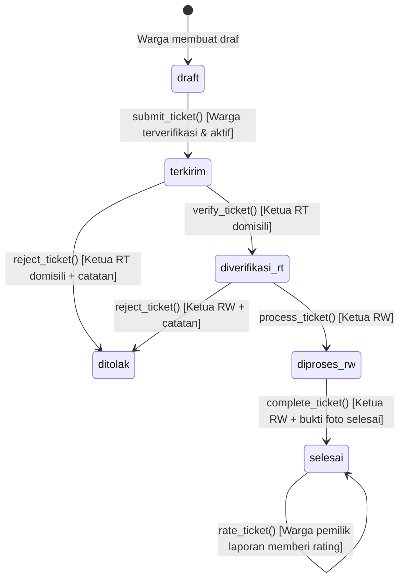

# SIPANDU — Sistem Informasi Pelayanan Warga Terpadu RW 06

> Platform digital tata kelola aspirasi, pelaporan masalah lingkungan, dan pelayanan publik warga RW 06 Parakan Saat, Kelurahan Cisaranten Endah, Kecamatan Arcamanik, Kota Bandung.
> Repositori ini dirancang khusus dengan target arsitektur **Hosted-Only**: **Next.js 16 di Vercel** dan **PostgreSQL 17, Authentication, Storage, & RPC di Supabase Hosted**.

---

## 🏛️ Target Arsitektur Hosted-Only

SIPANDU beroperasi sepenuhnya di atas infrastruktur *cloud-hosted* tanpa ketergantungan pada Docker, Docker Compose, maupun local database stack:

| Komponen | Platform Hosting | Cakupan Layanan |
|---|---|---|
| **Frontend & Runtime Server** | [Vercel](https://vercel.com/) | Next.js 16 App Router, Turbopack, Server Actions, Route Handlers, Edge Middleware |
| **Backend & Database** | [Supabase Hosted](https://supabase.com/) | PostgreSQL 17, Supabase Auth, Supabase Storage (`ticket-attachments`, `avatars`), RLS 100%, RPC Stored Procedures |

Pengembang dan evaluator dapat memasang, mengonfigurasi, menguji, dan menjalankan SIPANDU dari awal hanya dengan akun Vercel dan project Supabase Hosted baru tanpa perlu menginstal atau menjalankan Docker.

---

## 📋 Daftar Isi

1. [Tentang SIPANDU](#-tentang-sipandu)
2. [Peran Pengguna & Hierarki Akses (RBAC)](#-peran-pengguna--hierarki-akses-rbac)
3. [Alur Siklus Pengaduan (State Machine)](#-alur-siklus-pengaduan-state-machine)
4. [Tech Stack & Arsitektur Cloud](#-tech-stack--arsitektur-cloud)
5. [Silsilah Migrasi Database Kanonik (0001–0010)](#-silsilah-migrasi-database-kanonik-00010010)
6. [Prasyarat Sistem](#-prasyarat-sistem)
7. [Daftar Lengkap Environment Variables](#-daftar-lengkap-environment-variables)
8. [Panduan Setup Supabase Hosted & Migrasi](#-panduan-setup-supabase-hosted--migrasi)
   - [Langkah 1: Kloning Repositori & Instal Dependensi](#langkah-1-kloning-repositori--instal-dependensi)
   - [Langkah 2: Buat Project Baru di Supabase Dashboard](#langkah-2-buat-project-baru-di-supabase-dashboard)
   - [Langkah 3: Konfigurasi File Environment Lokal](#langkah-3-konfigurasi-file-environment-lokal)
   - [Langkah 4: Hubungkan Supabase CLI ke Project Hosted](#langkah-4-hubungkan-supabase-cli-ke-project-hosted)
   - [Langkah 5: Terapkan 10 Migrasi Kanonik ke Remote Database](#langkah-5-terapkan-10-migrasi-kanonik-ke-remote-database)
   - [Langkah 6: Bootstrap Root Administrator](#langkah-6-bootstrap-root-administrator)
9. [Panduan Deployment ke Vercel](#-panduan-deployment-ke-vercel)
10. [Menjalankan Aplikasi secara Lokal (Dev Mode)](#-menjalankan-aplikasi-secara-lokal-dev-mode)
11. [Seeding Pengguna & Tiket Demo (Staging Terpisah - Opsional)](#-seeding-pengguna--tiket-demo-staging-terpisah---opsional)
12. [Pengujian Backend & RLS (Dedicated Test Project)](#-pengujian-backend--rls-dedicated-test-project)
13. [Prinsip Keamanan & Tata Kelola Data](#-prinsip-keamanan--tata-kelola-data)
14. [Troubleshooting & FAQ](#-troubleshooting--faq)
15. [Lisensi & Referensi Dokumentasi](#-lisensi--referensi-dokumentasi)

---

## 📖 Tentang SIPANDU

**SIPANDU** (Sistem Informasi Pelayanan Warga Terpadu) adalah aplikasi web layanan publik berbasis komunitas yang mendigitalkan birokrasi warga di tingkat Rukun Warga (RW) dan Rukun Tetangga (RT).

SIPANDU diinisialisasi untuk wilayah **RW 06 Parakan Saat, Kelurahan Cisaranten Endah, Kecamatan Arcamanik, Kota Bandung** (mencakup RT 01 hingga RT 09). Arsitektur aplikasi bersifat *single-tenant* (1 instalasi melayani 1 RW), di mana identitas wilayah dapat disesuaikan dinamis melalui variabel lingkungan:
- `NEXT_PUBLIC_APP_RW`: Nomor RW (default: `"06"`).
- `NEXT_PUBLIC_APP_AREA_NAME`: Nama area atau rukun warga (default: `"Parakan Saat, Bandung"`).
- `NEXT_PUBLIC_APP_CITY`: Kota administrasi (default: `"Kota Bandung"`).

Pelaporan warga yang sebelumnya dilakukan secara lisan atau melalui grup pesan instan bertransformasi menjadi alur kerja yang **terstruktur, transparan, akuntabel, dan terlacak secara real-time**.

---

## 👥 Peran Pengguna & Hierarki Akses (RBAC)

SIPANDU menerapkan kontrol akses berbasis peran (*Role-Based Access Control*) berjenjang:

| Peran | Lingkup Wilayah | Tanggung Jawab & Hak Akses Kunci |
|---|:---:|---|
| **Warga** | RT domisili | Membuat draf laporan, mengunggah foto bukti laporan (*before*), mengirim tiket pengaduan (setelah akun diverifikasi oleh Ketua RT), memantau kronologi penanganan, serta memberikan rating dan ulasan setelah perbaikan selesai. |
| **Ketua RT** | RT binaan | Memverifikasi identitas pendaftaran warga di RT-nya (`verify_resident`), memeriksa kelayakan tiket warga setempat, memverifikasi tiket untuk diteruskan ke RW (`verify_ticket`), atau menolak tiket disertai alasan resmi (`reject_ticket`). |
| **Ketua RW** | RW 06 (RT 01–09) | Memproses tiket yang lolos verifikasi RT (`process_ticket`), mengoordinasikan penanganan lapangan, mengunggah bukti foto penyelesaian (*after*), menyelesaikan tiket (`complete_ticket`), serta memantau analitik dan rekap laporan seluruh RW. |
| **Admin** | Sistem / Global | Mengelola data master wilayah dan kategori, mengelola status akun pengguna (aktivasi/verifikasi/reset), menghapus/mengoreksi tiket bermasalah dengan audit trail, serta mengawasi integritas operasional sistem. |

---

## 🔄 Alur Siklus Pengaduan (State Machine)

Setiap tiket pengaduan melewati mesin status (*finite state machine*) yang diatur ketat oleh fungsi RPC PostgreSQL (`SECURITY DEFINER`):



Setiap transisi status secara otomatis mencatat riwayat ke tabel `ticket_timeline` dan mengirimkan entri notifikasi ke tabel `notifications`.

---

## 🛠 Tech Stack & Arsitektur Cloud

### Frontend & Application Layer (Hosted on Vercel)
- **Framework**: [Next.js](https://nextjs.org/) `16.4.3` (App Router, Turbopack, Server Actions)
- **Library UI**: [React](https://react.dev/) `19.3.1`
- **Styling**: [Tailwind CSS](https://tailwindcss.com/) `v4` (dengan `@tailwindcss/turbopack`)
- **Icons**: [Lucide React](https://lucide.dev/)
- **Bahasa**: [TypeScript](https://www.typescriptlang.org/) `v6` (Strict Mode)
- **Spreadsheet Export**: `xlsx` (Ekspor rekapitulasi data laporan untuk pengurus RW)

### Backend, Database & Storage Layer (Hosted on Supabase Cloud)
- **BaaS & Auth**: [Supabase Hosted](https://supabase.com/) (`@supabase/ssr` & `@supabase/supabase-js`)
- **Database Engine**: [PostgreSQL](https://www.postgresql.org/) `17`
- **Keamanan & Otorisasi**: Row Level Security (RLS) diaktifkan 100% pada seluruh tabel publik
- **Logika Server**: Stored Procedures / RPC Functions (`SECURITY DEFINER`) dengan parameterisasi aman
- **File Storage**: Supabase Storage Buckets (`ticket-attachments` dan `avatars`) yang diproteksi RLS tingkat objek

---

## 📜 Silsilah Migrasi Database Kanonik (0001–0010)

Seluruh struktur skema, keamanan, master data, dan logika database didefinisikan secara deklaratif dalam 10 file migrasi kanonik pada `supabase/migrations/`:

| No | File Migrasi | Deskripsi & Cakupan Fungsional |
|:---:|---|---|
| **01** | `20261101120001_sipandu_init.sql` | Inisialisasi enum tipe data, 7 tabel inti (`regions`, `categories`, `profiles`, `tickets`, `ticket_attachments`, `ticket_timeline`, `notifications`), baseline RLS, bucket `ticket-attachments`, serta seed master data RT 01–RT 08 & 6 kategori laporan. |
| **02** | `20261101120002_fix_attachments_and_indexes.sql` | Helper penghitung lampiran `_count_laporan_attachments`, policy insert lampiran foto, dan 7 indeks performa foreign key. |
| **03** | `20261101120003_verification_active_guards.sql` | Kolom `is_rt_verified`, helper `_is_caller_active()`, status active guards, dan proteksi profil warga dari modifikasi ilegal (dengan normalisasi delimiter fungsi `AS $$ ... $$;`). |
| **04** | `20261101120004_avatars_bucket.sql` | Pembuatan storage bucket publik `avatars` untuk foto profil pengguna. |
| **05** | `20261101122337_admin_rls_and_delete.sql` | Policy pembacaan bukti penyelesaian tiket oleh Admin & RW, serta policy penghapusan tiket administratif `tickets_admin_delete`. |
| **06** | `20261101122344_pending_user_verification.sql` | RPC `verify_resident(uuid, boolean)` dengan validasi wilayah RT, pengiriman notifikasi approval, dan pemblokiran pembuatan tiket warga pending. |
| **07** | `20261109000001_admin_protection_and_profile_guards.sql` | Helper role checking real-time (`_is_caller_admin`, `_get_caller_role`), trigger invariant admin terakhir (`tr_protect_last_admin`), trigger proteksi profil (`tr_check_profile_guards`), dan preflight assertion cerdas (melewati pemeriksaan dengan `NOTICE` pada database baru yang masih kosong / 0 user, serta mewajibkan minimal 1 Admin aktif pada database yang sudah berisi user). |
| **08** | `20261109000002_storage_and_privilege_hardening.sql` | Penambahan master data RT 09, penguatan 4 storage policies bucket `avatars` (`read`, `insert`, `update`, `delete`), schema anti-hijacking (`REVOKE CREATE ON SCHEMA public`), Principle of Least Privilege (PoLP) tabel dan fungsi, serta default privileges. |
| **09** | `20261109000003_deduplicate_rt09_and_unique_constraint.sql` | Deduplikasi dinamis record wilayah RT 09, penataan ulang sequence `public.regions.id` via `ALTER SEQUENCE ... RESTART WITH`, dan penambahan constraint integritas `UNIQUE (name, rw)` pada `public.regions`. |
| **10** | `20261110000001_fix_null_region_auth_bypass.sql` | Perbaikan celah otorisasi wilayah *three-valued logic* (`NULL` comparison) pada RPC `verify_ticket`, `reject_ticket`, dan `verify_resident` menggunakan validasi eksplisit `IS NULL` serta operator NULL-safe `IS DISTINCT FROM`. |

---

## 💻 Prasyarat Sistem

Sebelum memulai instalasi, pastikan dependensi berikut terpasang pada komputer pengembang:

- **Node.js**: `v20.x` LTS atau lebih baru (`node -v`)
- **Package Manager**: `npm` `v9+` atau `v10+` (`npm -v`)
- **Supabase CLI**: `v3.0.0+` (`npx supabase -v`)
- **Git**: Terpasang untuk kloning repositori (`git -v`)
- **Akun Layanan Cloud**:
  - Akun [Supabase](https://supabase.com/) aktif untuk membuat project hosted baru.
  - Akun [Vercel](https://vercel.com/) aktif untuk deployment aplikasi web.

> [!NOTE]
> Tidak memerlukan Docker, Docker Compose, maupun PostgreSQL lokal. Seluruh workflow migrasi dan runtime aplikasi ditujukan langsung ke layanan Supabase Hosted dan Vercel.

---

## 🔐 Daftar Lengkap Environment Variables

Berdasarkan audit menyeluruh terhadap kode sumber aplikasi, berikut adalah daftar variabel lingkungan yang digunakan:

### A. Variabel Publik Frontend (`NEXT_PUBLIC_*`)
Variabel ini dibaca oleh Next.js dan di-inline ke dalam JavaScript bundle saat proses build. Setiap perubahan nilai memerlukan build / redeployment ulang di Vercel agar berlaku pada klien.

| Nama Variabel | Wajib / Opsional | Deskripsi & Contoh Nilai |
|---|:---:|---|
| `NEXT_PUBLIC_SUPABASE_URL` | **Wajib** | URL instance Supabase Hosted Anda, contoh: `https://<project-ref>.supabase.co` |
| `NEXT_PUBLIC_SUPABASE_ANON_KEY` | **Wajib** | Supabase Anon Key (aman untuk browser frontend) |
| `NEXT_PUBLIC_APP_NAME` | Opsional | Nama singkat aplikasi (default: `"SIPANDU"`) |
| `NEXT_PUBLIC_APP_RW` | Opsional | Nomor RW cakupan aplikasi (default: `"06"`) |
| `NEXT_PUBLIC_APP_AREA_NAME` | Opsional | Nama wilayah atau kelurahan (default: `"Parakan Saat, Bandung"`) |
| `NEXT_PUBLIC_APP_CITY` | Opsional | Kota administrasi (default: `"Kota Bandung"`) |
| `NEXT_PUBLIC_APP_CONTACT_ADDRESS` | Opsional | Alamat sekretariat RW untuk halaman bantuan (default: `null`) |
| `NEXT_PUBLIC_APP_CONTACT_PHONE` | Opsional | Nomor telepon / WhatsApp sekretariat RW (default: `null`) |

### B. Variabel Server-Side Secret
Variabel ini bersifat rahasia dan **HANYA** digunakan oleh runtime server (Server Actions, Route Handlers) di Vercel serta skrip administratif di terminal lokal pengembang.

| Nama Variabel | Wajib / Opsional | Deskripsi |
|---|:---:|---|
| `SUPABASE_SERVICE_ROLE_KEY` | **Wajib** | Supabase Service Role Secret Key. Memiliki akses penuh melewati RLS. **DILARANG KERAS** diekspos ke klien browser, dimasukkan ke repositori Git, atau diberi prefix `NEXT_PUBLIC_`. |

### C. Variabel Pengaman Eksekusi Skrip (CLI Guards)
Digunakan secara kondisional saat mengeksekusi skrip pengujian atau seeding data:

| Nama Variabel | Wajib / Opsional | Deskripsi |
|---|:---:|---|
| `PROTECTED_SUPABASE_PROJECT_REFS` | Rekomendasi | Daftar project ref (dipisahkan koma) yang mutlak dilindungi dari eksekusi skrip destruktif/seeding. |
| `ALLOW_DESTRUCTIVE_TEST` | Khusus Uji | Wajib disetel `"true"` untuk konfirmasi eksekusi mutasi pengujian pada backend test suite. |
| `ALLOW_REMOTE_HOSTED_TEST` | Khusus Uji | Wajib disetel `"true"` untuk mengizinkan penargetan remote Supabase Hosted pada pengujian. |
| `ALLOWED_TEST_PROJECT_REF` | Khusus Uji | Project ref target pengujian yang harus cocok persis dengan ref pada URL Supabase. |
| `TEST_PASSWORD` | Khusus Uji | Password akun uji coba untuk autentikasi test suite. |
| `ALLOW_DEMO_SEED` | Khusus Seeding | Wajib disetel `"true"` untuk konfirmasi eksekusi seeding demo. |
| `ALLOWED_DEMO_PROJECT_REF` | Khusus Seeding | Project ref staging target yang harus cocok persis dengan ref pada URL Supabase. |
| `DEMO_PASSWORD` | Khusus Seeding | Password akun demo yang akan dibuat (minimal 8 karakter). |

---

## 🚀 Panduan Setup Supabase Hosted & Migrasi

### Langkah 1: Kloning Repositori & Instal Dependensi

```bash
git clone https://github.com/Kelompok-60B-UT/SIPANDU.git
cd SIPANDU
npm install
```

### Langkah 2: Buat Project Baru di Supabase Dashboard

1. Buka [Supabase Dashboard](https://supabase.com/dashboard) dan buat organisasi atau project baru.
2. Beri nama project (misalnya `sipandu-rw06`), tentukan password database PostgreSQL yang kuat, dan pilih region terdekat (misalnya `Singapore` - `ap-southeast-1`).
3. Tunggu hingga proses provisi database selesai (sekitar 1–2 menit).
4. Masuk ke menu **Project Settings** -> **API**, lalu catat:
   - **Project URL** (`https://<project-ref>.supabase.co`)
   - **Project Reference ID** (`<project-ref>`)
   - **anon / public key**
   - **service_role key** (Secret)

### Langkah 3: Konfigurasi File Environment Lokal

Salin template konfigurasi lingkungan:

```bash
cp .env.example .env.local
```

Buka `.env.local` dan isi dengan kredensial project Supabase Hosted yang baru dibuat:

```env
NEXT_PUBLIC_SUPABASE_URL="https://<YOUR_PROJECT_REF>.supabase.co"
NEXT_PUBLIC_SUPABASE_ANON_KEY="<YOUR_ANON_KEY>"
SUPABASE_SERVICE_ROLE_KEY="<YOUR_SERVICE_ROLE_KEY>"
```

### Langkah 4: Hubungkan Supabase CLI ke Project Hosted

Login ke akun Supabase Anda melalui CLI:

```bash
npx supabase login
```

Tautkan workspace lokal ke project hosted baru:

```bash
npx supabase link --project-ref <YOUR_PROJECT_REF>
```

### Langkah 5: Terapkan 10 Migrasi Kanonik ke Remote Database

Sebelum menerapkan perubahan skema ke remote database, selalu lakukan pemeriksaan awal dengan opsi `--dry-run`:

```bash
# 1. Periksa daftar migrasi yang akan diterapkan ke remote:
npx supabase db push --remote --dry-run

# 2. Terapkan seluruh migrasi kanonik ke database remote (wajib menyertakan flag --remote eksplisit):
npx supabase db push --remote
```

> [!IMPORTANT]
> Pastikan selalu menyertakan flag `--remote` secara eksplisit. Jangan menggunakan opsi `--yes` agar operator selalu dapat meninjau konfirmasi target sebelum migrasi dieksekusi. Berkas migrasi `0007` secara cerdas mendeteksi database kosong (0 akun) dan menerapkan seluruh 10 migrasi secara tuntas dalam satu tahap.

### Langkah 6: Bootstrap Root Administrator

Setelah 10 berkas migrasi terpasang, buat akun Administrator perdana menggunakan skrip bootstrap resmi yang memanfaatkan Supabase Auth Admin API:

```bash
ADMIN_EMAIL="admin@sipandu.id" \
ADMIN_PASSWORD="GantiDenganPasswordKuatMin12Karakter!" \
NEXT_PUBLIC_SUPABASE_URL="https://<YOUR_PROJECT_REF>.supabase.co" \
SUPABASE_SERVICE_ROLE_KEY="<YOUR_SERVICE_ROLE_KEY>" \
npx tsx scripts/bootstrap-admin.ts
```

Skrip ini akan mendaftarkan akun di `auth.users`, menetapkan klaim tepercaya `app_metadata.sipandu_role = 'admin'`, dan menyinkronkan profil aktif di tabel `public.profiles` (`is_active = true`, `is_rt_verified = true`).

---

## ☁️ Panduan Deployment ke Vercel

Setelah database Supabase Hosted siap dan akun Administrator telah dibuat, deploy aplikasi Next.js ke Vercel:

1. **Push repositori** ke akun GitHub organisasi Anda.
2. Buka [Vercel Dashboard](https://vercel.com/new) dan impor repositori **SIPANDU**.
3. **Konfigurasi Project**:
   - **Framework Preset**: Pilih `Next.js`.
   - **Root Directory**: `./`.
   - **Build Command**: `next build` (bawaan).
   - **Output Directory**: `.next` (bawaan).
4. **Environment Variables**:
   Tambahkan variabel lingkungan berikut pada dashboard Vercel (pilih environment *Production* dan *Preview*):
   - `NEXT_PUBLIC_SUPABASE_URL`: `https://<YOUR_PROJECT_REF>.supabase.co`
   - `NEXT_PUBLIC_SUPABASE_ANON_KEY`: `<YOUR_ANON_KEY>`
   - `SUPABASE_SERVICE_ROLE_KEY`: `<YOUR_SERVICE_ROLE_KEY>`
   - `NEXT_PUBLIC_APP_NAME`: `SIPANDU`
   - `NEXT_PUBLIC_APP_RW`: `06`
   - `NEXT_PUBLIC_APP_AREA_NAME`: `Parakan Saat, Bandung`
   - `NEXT_PUBLIC_APP_CITY`: `Kota Bandung`
5. **Deploy**: Klik tombol **Deploy** dan tunggu proses kompilasi Next.js selesai hingga Vercel menerbitkan domain produksi (misalnya `https://sipandu-rw06.vercel.app`).
6. **Sesuaikan Supabase Auth Redirect URLs**:
   Masuk ke **Supabase Dashboard** -> **Authentication** -> **URL Configuration**:
   - **Site URL**: Masukkan domain produksi Vercel Anda (misalnya `https://sipandu-rw06.vercel.app`).
   - **Redirect URLs**: Tambahkan:
     - `https://sipandu-rw06.vercel.app/**`
     - `https://sipandu-rw06.vercel.app/auth/callback`

---

## 🏃 Menjalankan Aplikasi secara Lokal (Dev Mode)

Jika Anda ingin menjalankan server Next.js pada komputer lokal dengan menghubungkan frontend ke database Supabase Hosted yang sudah dikonfigurasi pada `.env.local`:

```bash
# Menjalankan development server Next.js (Turbopack)
npm run dev

# Memeriksa kualitas kode melalui ESLint
npm run lint

# Memeriksa kompilasi build produksi Next.js
npm run build
```

Buka [http://localhost:3000](http://localhost:3000) pada peramban web Anda.

---

## 🎭 Seeding Pengguna & Tiket Demo (Staging Terpisah - Opsional)

> [!CAUTION]
> Skrip seeding data demo **BUKAN** bagian wajib dari deployment produksi.
> Skrip ini **DILARANG KERAS** dijalankan pada database produksi maupun project demo hosted yang dilindungi (`PROTECTED_SUPABASE_PROJECT_REFS`).
> Seeding hanya boleh dijalankan pada project Supabase Hosted khusus staging/evaluasi terpisah dengan opt-in eksplisit bertingkat:

```bash
# 1. Provisioning 7 Akun Demo Lintas Peran:
ALLOW_DEMO_SEED=true \
ALLOWED_DEMO_PROJECT_REF="<YOUR_STAGING_PROJECT_REF>" \
DEMO_PASSWORD="DemoPassword123!" \
NEXT_PUBLIC_SUPABASE_URL="https://<YOUR_STAGING_PROJECT_REF>.supabase.co" \
SUPABASE_SERVICE_ROLE_KEY="<YOUR_SERVICE_ROLE_KEY>" \
npx tsx scripts/seed-demo-users.ts

# 2. Provisioning 6 Tiket Demo Lintas Status Alur Kerja:
ALLOW_DEMO_SEED=true \
ALLOWED_DEMO_PROJECT_REF="<YOUR_STAGING_PROJECT_REF>" \
NEXT_PUBLIC_SUPABASE_URL="https://<YOUR_STAGING_PROJECT_REF>.supabase.co" \
SUPABASE_SERVICE_ROLE_KEY="<YOUR_SERVICE_ROLE_KEY>" \
npx tsx scripts/seed-demo-tickets.ts
```

Daftar akun demo yang terbentuk pada project staging:
- `admin@sipandu.test` (Admin)
- `rw06@sipandu.test` (Ketua RW 06)
- `rt01@sipandu.test` (Ketua RT 01)
- `rt02@sipandu.test` (Ketua RT 02)
- `warga1@sipandu.test` (Warga RT 01 - Terverifikasi)
- `warga2@sipandu.test` (Warga RT 02 - Terverifikasi)
- `warga.pending@sipandu.test` (Warga RT 01 - Menunggu Verifikasi RT)

---

## 🧪 Pengujian Backend & RLS (Dedicated Test Project)

SIPANDU menyertakan test suite terintegrasi (`scripts/test-backend.ts`) yang memvalidasi lebih dari 40 skenario keamanan RLS, otorisasi peran, dan integritas state machine.

> [!WARNING]
> Test suite melakukan operasi mutasi data terisolasi dan dilindungi oleh *fail-closed target guard*. Script **DILARANG** dijalankan pada database produksi maupun database demo hosted yang dilindungi. Pengujian wajib menggunakan **dedicated Supabase Hosted test project** terpisah.

Jalankan pengujian pada project uji Supabase Hosted tersendiri:

```bash
ALLOW_DESTRUCTIVE_TEST=true \
ALLOW_REMOTE_HOSTED_TEST=true \
ALLOWED_TEST_PROJECT_REF="<YOUR_TEST_PROJECT_REF>" \
TEST_PASSWORD="DemoPassword123!" \
NEXT_PUBLIC_SUPABASE_URL="https://<YOUR_TEST_PROJECT_REF>.supabase.co" \
NEXT_PUBLIC_SUPABASE_ANON_KEY="<YOUR_TEST_ANON_KEY>" \
SUPABASE_SERVICE_ROLE_KEY="<YOUR_TEST_SERVICE_ROLE_KEY>" \
npx tsx scripts/test-backend.ts
```

---

## 🛡️ Prinsip Keamanan & Tata Kelola Data

1. **Principle of Least Privilege (PoLP)**:
   - Izin pembuatan objek pada schema publik dicabut (`REVOKE CREATE ON SCHEMA public FROM PUBLIC`).
   - Peran `anon` dan `authenticated` hanya memiliki izin `SELECT` pada tabel yang diizinkan. Mutasi data dibatasi melalui hak akses kolom dan RLS policies.
   - Eksekusi fungsi RPC sensitif dicabut dari `PUBLIC` dan hanya diberikan eksplisit kepada `authenticated` atau `service_role`.
2. **Perlindungan Invariant Administrator Terakhir**:
   - Database trigger `tr_protect_last_admin` menolak operasi `DELETE`, penonaktifan (`is_active = false`), atau demosi terhadap satu-satunya admin aktif yang tersisa.
3. **Verifikasi Warga oleh RT**:
   - Akun warga baru memiliki status `is_rt_verified = false`. Pembuatan atau pengiriman tiket diblokir pada tingkat RLS dan RPC hingga disetujui oleh Ketua RT setempat.
4. **Klaim Autentikasi Tepercaya**:
   - Peran pengguna disimpan pada `auth.users.app_metadata.sipandu_role` yang hanya dapat dimutasi melalui koneksi server/service role tepercaya. Trigger database mencegah manipulasi peran melalui `user_metadata` saat registrasi publik.
5. **Integritas Audit Trail**:
   - Tabel `ticket_timeline` bersifat *append-only* untuk menjamin rekam jejak setiap pergantian status pengaduan.

---

## ❓ Troubleshooting & FAQ

### 1. Warga tidak dapat mengirimkan laporan (Tombol Submit dinonaktifkan)
- **Penyebab**: Akun warga berstatus belum diverifikasi (`is_rt_verified = false`).
- **Solusi**: Masuk sebagai Ketua RT dari wilayah warga tersebut, buka menu persetujuan warga, dan berikan verifikasi persetujuan.

### 2. Error `relation already exists` saat menjalankan migrasi
- **Penyebab**: Database sudah memiliki tabel dari migrasi sebelumnya namun belum tercatat pada tabel histori migrasi Supabase.
- **Solusi**: Gunakan perintah `npx supabase migration repair <MIGRATION_ID> --status applied` untuk menyelaraskan riwayat migrasi, atau jalankan pada database Supabase Hosted baru yang bersih (*blank database*).

### 3. Error `TARGET GUARD BLOCKED` saat menjalankan test backend
- **Penyebab**: Target URL terdeteksi sebagai project yang dilindungi (`PROTECTED_SUPABASE_PROJECT_REFS`), domain produksi, atau ketiadaan flag `ALLOW_REMOTE_HOSTED_TEST=true` dan `ALLOWED_TEST_PROJECT_REF`.
- **Solusi**: Jalankan test suite pada project uji Supabase Hosted tersendiri dengan menyertakan flag konfirmasi `ALLOW_DESTRUCTIVE_TEST=true`, `ALLOW_REMOTE_HOSTED_TEST=true`, dan `ALLOWED_TEST_PROJECT_REF="<ref>"`.

---

## 📄 Lisensi & Referensi Dokumentasi

Dokumentasi detail operasional dan panduan teknis deployment dapat dilihat pada:
- [`INSTALL_RUNBOOK.md`](docs/deployment/INSTALL_RUNBOOK.md): Panduan instalasi dan deployment teknis terperinci.
- [`AGENTS.md`](AGENTS.md): Panduan arsitektur Next.js.

Proyek ini dikembangkan oleh **Kelompok 60B UT** sebagai tugas akhir *Capstone Project* Sistem Informasi Pelayanan Warga.
